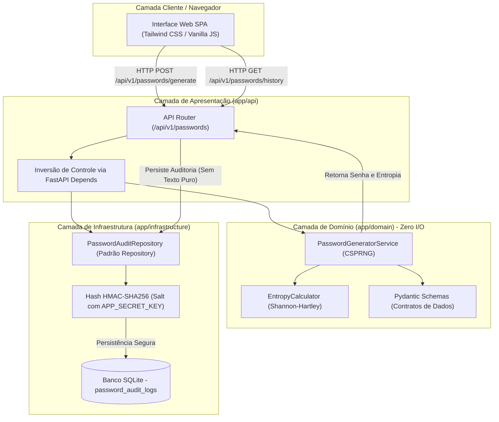
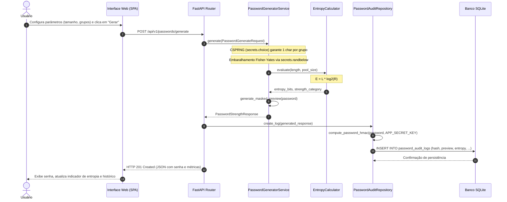

# SaferPassForge 🛡️

> **Gerador Criptograficamente Seguro de Senhas com Auditoria de Entropia em Tempo Real**  
> *Projeto acadêmico desenvolvido no âmbito da Especialização em Engenharia de Software (2026).*

---

[](https://www.python.org/downloads/)
[](https://fastapi.tiangolo.com)
[](https://www.sqlalchemy.org/)
[](https://www.sqlite.org/)
[](https://docs.pytest.org/)
[](LICENSE)
[](https://conventionalcommits.org)

---

## 📖 1. Sobre o Projeto e Estágios do SDLC

O **SaferPassForge** é um sistema completo concebido para solucionar os riscos associados ao uso de geradores pseudoaleatórios inseguros e ao armazenamento indevido de segredos. Construído como MVP acadêmico, o projeto aplica as melhores práticas de **Engenharia de Software**, **Arquitetura em Camadas** e **Security-by-Design**.

O desenvolvimento percorreu sistematicamente os estágios do **Ciclo de Vida de Desenvolvimento de Software (SDLC)**:

| Estágio do SDLC | Atividades e Entregáveis no Projeto |
| :--- | :--- |
| **1. Planejamento & Governança** | Definição das diretrizes no [AGENTS.md](AGENTS.md), convenção estrita de commits (*Conventional Commits One-Liner*), licença MIT e matriz de dependências pinadas. |
| **2. Design & Domínio** | Modelagem da camada `app/domain` com tipagem forte via Pydantic v2, motor CSPRNG puramente nativo (`secrets`) e cálculo de entropia de Shannon-Hartley. |
| **3. Persistência de Dados** | Modelagem da camada `app/infrastructure` em SQLAlchemy 2.0, isolamento via *Repository Pattern* e proteção criptográfica com **HMAC-SHA256**. |
| **4. Apresentação & UI** | Exposição de endpoints RESTful no FastAPI com injeção de dependência (`Depends`) e interface web integrada responsiva em Tailwind CSS (Dark Mode). |
| **5. Garantia de Qualidade (QA)** | Bateria completa de testes automatizados com Pytest estruturada no padrão **AAA (Arrange, Act, Assert)** e SQLite em memória isolado via `StaticPool`. |
| **6. Documentação & Entrega** | Documentação técnica executiva com diagramas arquiteturais Mermaid.js e instruções completas de inicialização. |

---

## 📐 2. Princípios de Engenharia Aplicados

A base de código foi desenvolvida sob quatro pilares mandatórios:

### 2.1 KISS (*Keep It Simple, Stupid*)
- **Frontend Direto**: Uso do Tailwind CSS via CDN e JavaScript puro (*Vanilla JS*) com Fetch API e funções assíncronas, eliminando a sobrecarga de ferramentas complexas como Node.js, Webpack ou Vite.
- **Funções Puras**: Serviços de geração e cálculo matemático sem efeitos colaterais ou complexidade cognitiva excessiva.

### 2.2 YAGNI (*You Aren't Gonna Need It*)
- **Escopo Estrito de MVP**: Implementação exclusiva das funcionalidades essenciais de geração, avaliação de entropia e auditoria protegida.
- **Dependências Zero-Overhead**: Ausência de bibliotecas ociosas; todo gerador baseia-se exclusivamente no módulo padrão `secrets` do Python.

### 2.3 DRY (*Don't Repeat Yourself*)
- **Configuração Centralizada**: Variáveis de ambiente consolidadas e validadas em `app/config.py` via `pydantic-settings` e otimizadas com cache `@lru_cache`.
- **Cálculo Único de Entropia**: O algoritmo de Shannon-Hartley é centralizado em `EntropyCalculator`, reaproveitado por todos os pontos da aplicação.
- **Fixtures Reutilizáveis**: Base de dados em memória e cliente de teste compartilhados centralmente no `tests/conftest.py`.

### 2.4 SOLID Architecture & Separação de Preocupações
- **S (Single Responsibility)**: `EntropyCalculator` apenas computa entropia; `PasswordGeneratorService` apenas gera senhas; `PasswordAuditRepository` apenas lida com I/O de persistência.
- **O (Open/Closed)**: Conjuntos de caracteres, filtros e limiares de classificação são extensíveis sem necessidade de reescrever o algoritmo gerador.
- **L (Liskov Substitution)**: Contratos de entrada e saída baseados em Pydantic (`PasswordGenerateRequest` e `PasswordStrengthResponse`) garantem substituição transparente.
- **I (Interface Segregation)**: Separação clara entre o esquema retornado ao usuário gerador (`PasswordStrengthResponse`) e o esquema exposto ao histórico (`PasswordAuditItem`), impedindo vazamento de dados.
- **D (Dependency Inversion)**: A camada de domínio não possui acoplamento com o FastAPI ou SQLAlchemy. A camada de apresentação injeta serviços e repositórios através de `fastapi.Depends`.

---

## 🏛️ 3. Arquitetura do Sistema (Mermaid.js)

### 3.1 Diagrama de Componentes (Arquitetura em Camadas)



### 3.2 Diagrama de Sequência (Ciclo de Vida da Geração)



---

## 📁 4. Estrutura de Diretórios

```text
SaferPassForge/
├── .env                  # Variáveis de ambiente locais (ignorado no Git)
├── .env.example          # Template seguro documentado para novos ambientes
├── .gitignore            # Regras estritas de exclusão (Python, SQLite, IDEs, .env)
├── AGENTS.md             # Governança de repositório, regras para IA e Git policy
├── LICENSE               # Licença permissiva MIT (2026)
├── README.md             # Documentação técnica e executiva do projeto
├── requirements.txt      # Dependências com versões estritamente fixadas
├── app/
│   ├── __init__.py       # Metadados e versão do pacote da aplicação
│   ├── config.py         # Configurações com Pydantic Settings e validação de ambiente
│   ├── main.py           # Ponto de entrada FastAPI, ciclo de vida (lifespan) e estáticos
│   ├── api/
│   │   ├── __init__.py   # Exportação do roteador da API
│   │   └── routes.py     # Endpoints RESTful (/health, /generate, /history)
│   ├── domain/
│   │   ├── __init__.py   # Exportação da camada de domínio pura
│   │   ├── schemas.py    # Contratos Pydantic v2 de entrada e saída
│   │   └── services.py   # Gerador CSPRNG e calculador de entropia Shannon-Hartley
│   ├── infrastructure/
│   │   ├── __init__.py   # Exportação dos componentes de persistência
│   │   ├── database.py   # Conexão SQLAlchemy 2.0, SessionLocal e get_db()
│   │   ├── models.py     # Modelo ORM PasswordAuditLog e computação de HMAC-SHA256
│   │   └── repository.py # Implementação do padrão Repository para auditoria
│   └── static/
│       ├── index.html    # Interface Web moderna em Tailwind CSS (Dark Mode)
│       └── app.js        # Lógica assíncrona de frontend e integração com a API
└── tests/
    ├── __init__.py
    ├── conftest.py       # Fixtures Pytest: SQLite em memória isolado (StaticPool)
    ├── test_api.py       # Testes de integração dos endpoints HTTP
    ├── test_config.py    # Testes unitários do carregamento seguro de configurações
    ├── test_generator.py # Testes unitários do motor gerador e cálculo de entropia
    └── test_infrastructure.py # Testes unitários de persistência e repositório
```

---

## 🔒 5. Configuração de Variáveis de Ambiente e Segurança

O **SaferPassForge** adota **Security-by-Design** irrestrito:

- **Proibição Absoluta de Segredos Versionados**: Senhas, chaves privadas e arquivos `.env` jamais entram no histórico do Git (protegidos via `.gitignore`).
- **Sanitização de Dados**: O banco SQLite de auditoria **nunca armazena senhas em texto puro**. Apenas o hash com salt **HMAC-SHA256** (utilizando `APP_SECRET_KEY`) e máscaras parciais (ex: `aB************9!`) são persistidos.

### Variáveis Configuradas (`.env.example`):

| Variável | Tipo | Padrão | Descrição |
| :--- | :--- | :--- | :--- |
| `APP_NAME` | `str` | `"SaferPassForge"` | Nome identificador do serviço. |
| `APP_ENV` | `str` | `"development"` | Ambiente de execução (`development`, `testing`, `production`). |
| `APP_SECRET_KEY` | `str` | *Obrigatório (mín. 16 chars)* | Chave criptográfica usada no salteamento do HMAC-SHA256. |
| `DATABASE_URL` | `str` | `"sqlite:///./saferpassforge.db"` | URL de conexão do SQLAlchemy (SQLite para o MVP). |
| `DEFAULT_PASSWORD_LENGTH` | `int` | `16` | Comprimento padrão inicial sugerido pelo gerador. |

---

## 🚀 6. Como Executar o Projeto (Passo a Passo)

### Pré-requisitos
- **Python 3.11+** instalado.
- **Git** instalado.

### 6.1 Clonar o Repositório
```bash
git clone https://github.com/gerazuk/SaferPassForge.git
cd SaferPassForge
```

### 6.2 Criar e Ativar o Ambiente Virtual

#### No Windows (PowerShell):
```powershell
python -m venv .venv
.venv\Scripts\Activate.ps1
```

#### No Linux / macOS:
```bash
python3 -m venv .venv
source .venv/bin/activate
```

### 6.3 Instalar as Dependências Fixadas
```bash
pip install -r requirements.txt
```

### 6.4 Configurar o Arquivo de Ambiente
Copie o template seguro para criar seu arquivo local `.env`:

#### Windows (PowerShell):
```powershell
Copy-Item .env.example .env
```

#### Linux / macOS:
```bash
cp .env.example .env
```

*(Se desejar, edite o arquivo `.env` para ajustar a chave `APP_SECRET_KEY` de desenvolvimento).*

### 6.5 Iniciar a Aplicação
```bash
uvicorn app.main:app --reload --host 127.0.0.1 --port 8000
```

### 6.6 Acessar no Navegador
- 🌐 **Interface Web Interativa**: [http://127.0.0.1:8000](http://127.0.0.1:8000)
- 📚 **Documentação Interativa Swagger**: [http://127.0.0.1:8000/docs](http://127.0.0.1:8000/docs)
- 📖 **Documentação Alternativa ReDoc**: [http://127.0.0.1:8000/redoc](http://127.0.0.1:8000/redoc)

---

## 🧪 7. Como Executar os Testes Automatizados

A suíte foi concebida para rodar de forma rápida, determinística e sem persistir dados no banco de desenvolvimento, utilizando **SQLite em memória**:

```bash
# Execução padrão dos testes
pytest

# Execução detalhada (verbose)
pytest -v

# Executar módulo específico
pytest tests/test_generator.py
```

### Cobertura da Suíte:
- **`tests/test_config.py`**: Validação de schema, limites e leitura do `.env`.
- **`tests/test_generator.py`**: Comprimento exato, inclusão de categorias, filtro de ambíguos, precisão matemática de Shannon-Hartley e isolamento estrito de domínio.
- **`tests/test_infrastructure.py`**: Computação de HMAC determinístico, ordenação de histórico e limpeza segura de registros.
- **`tests/test_api.py`**: Healthcheck, ciclo de vida de geração e auditoria, verificação de ausência de texto puro e entrega do HTML estático.

---

## 🤖 8. Governança com Agentes de IA (`AGENTS.md`)

Este repositório estabelece regras mandatórias para desenvolvimento assistido por inteligência artificial documentadas no [AGENTS.md](AGENTS.md):
- **Conventional Commits One-Liner**: Commits em inglês, minúsculas, linha única e até 72 caracteres (ex: `feat(core): implement cryptographic password generator`).
- **Security Guardrails**: Proibição de inclusão de credenciais em código ou histórico.
- **Isolamento de Camadas**: Proibição de bibliotecas web ou de banco na camada de domínio.

---

## 📄 9. Licença

Este projeto é distribuído sob os termos da licença **MIT**. Consulte o arquivo [LICENSE](LICENSE) para mais detalhes.

